# DynamoDB to S3 Scheduled Backup: Lab Report

**Region:** us-west-2 (Oregon)
**AWS Account ID:** XXXXXXXXXXXX (redacted)

---

## 1. Architecture

```text
jsonplaceholder.typicode.com/users (public API)
        |
        | HTTP GET (10 users)
        v
[Lambda #1: import-jsonplaceholder-users]
        |
        | dynamodb:PutItem
        v
[DynamoDB: jsonplaceholder-users]   (partition key: id, Number)
        |
        | dynamodb:Scan
        v
[Lambda #2: export-dynamodb-to-s3] <--- [EventBridge Scheduler, rate(2 minutes)]
        |
        | s3:PutObject
        v
[Private S3 bucket] backups/YYYY-MM-DD/users-HH-MM-SS-micro-REQUESTID.json

Both Lambda functions write to CloudWatch Logs and Metrics.
```

Lambda #1 is invoked manually. Lambda #2 is invoked automatically by EventBridge Scheduler every 2 minutes.

---

## 2. Submission checklist

### 2.1 Architecture
Explained in Section 1. Data flows from the public API through Lambda #1 into DynamoDB, then through a DynamoDB Scan in Lambda #2 into timestamped JSON files in S3.

### 2.2 DynamoDB table
- Table name: `jsonplaceholder-users`
- Partition key: `id` (Number)
- Status: Active, Capacity mode: On-demand, Item count: 10
- Point-in-time recovery (PITR): Off

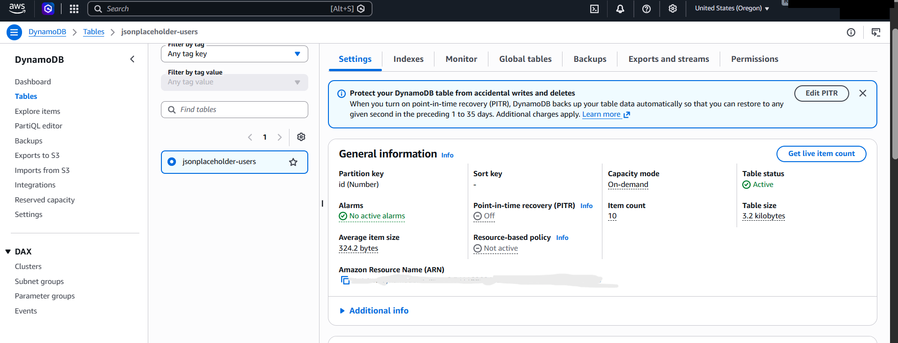

### 2.3 Lambda #1 (import)
- Manual test returned `statusCode 200`, `saved_count 10`.
- CloudWatch logs show successful writes to `jsonplaceholder-users`.

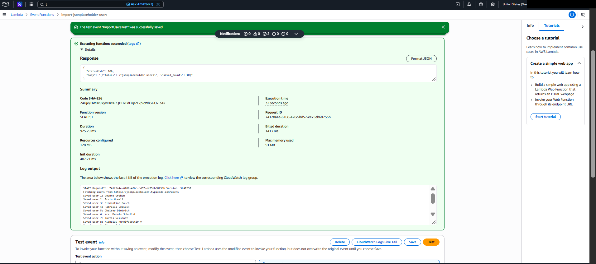
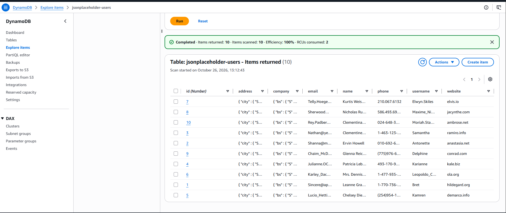
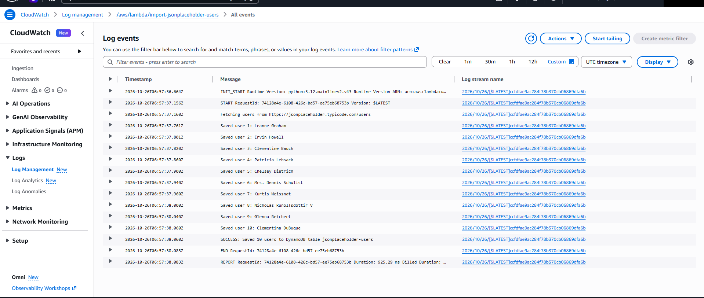

### 2.4 Lambda #2 (export) manual test and S3 export
- Export log: `SUCCESS: Exported 10 users to s3://student-lambda-backups-.../backups/2026-10-26/users-...json`
- Each run writes a new file with a unique timestamp and request ID. Files are not overwritten.

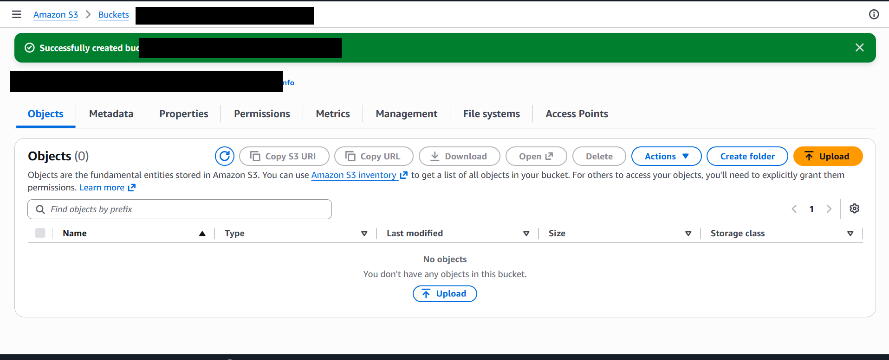
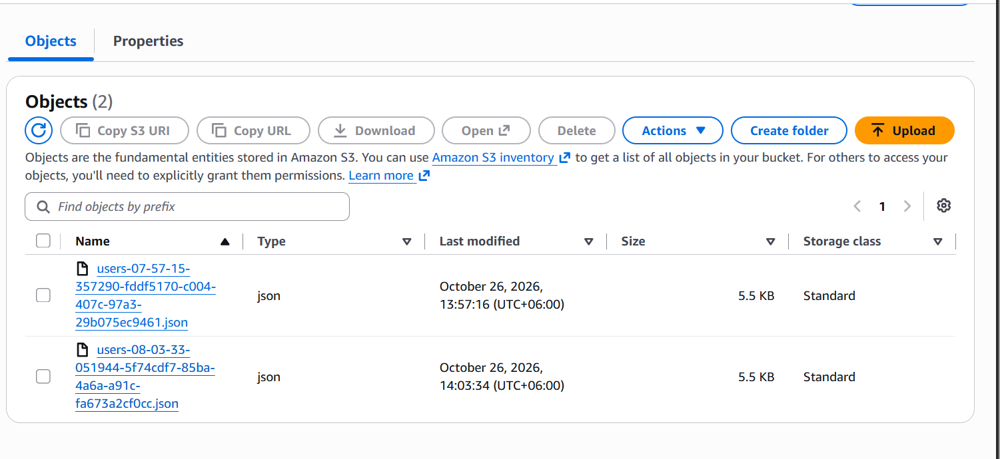
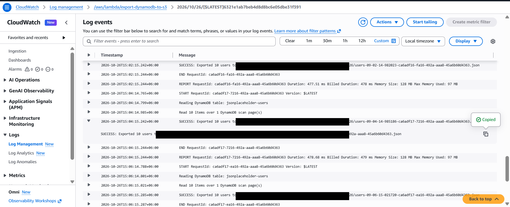

### 2.5 IAM
- **Lambda #1 role** (`import-jsonplaceholder-users-role-...`): policy `AllowPutDemoUsers` allows only `dynamodb:PutItem` on the `jsonplaceholder-users` table.
- **Lambda #2 role** (`export-dynamodb-to-s3-role-...`): policy `AllowDynamoDBJsonBackup` allows `dynamodb:Scan` on the `jsonplaceholder-users` table and `s3:PutObject` on `backups/*` in the lab bucket only.

**Why these permissions:**
- Lambda #1 only **writes** user records into DynamoDB, so it needs `dynamodb:PutItem` and nothing else. It does not read or delete data.
- Lambda #2 must **read** all items from the table, which requires `dynamodb:Scan`, and **write** JSON files to S3, which requires `s3:PutObject`. It does not need write access to DynamoDB, so none is granted.
- Both policies are scoped to one table or one S3 prefix (`backups/*`), not to all resources. This is least privilege: each function can do only what its job requires.

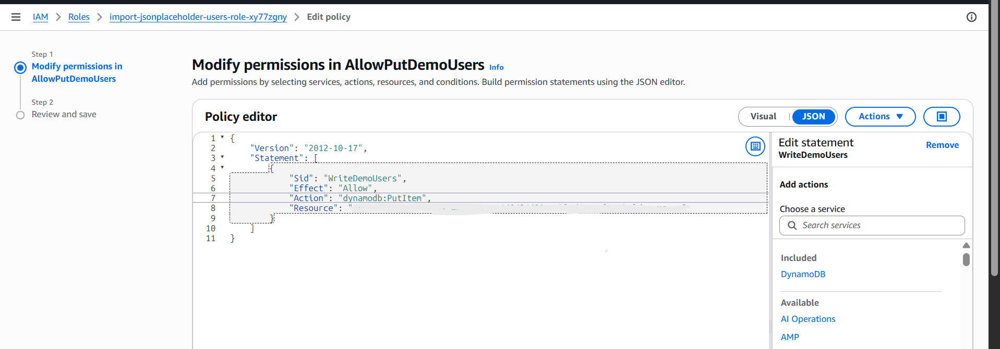
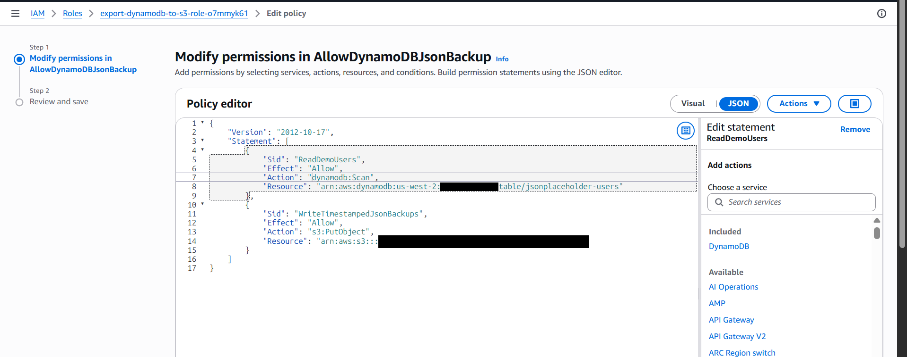

### 2.6 EventBridge Scheduler
- Schedule `dynamodb-backup-every-2min`, rate `rate(2 minutes)`, target Lambda #2, status Enabled during the test.

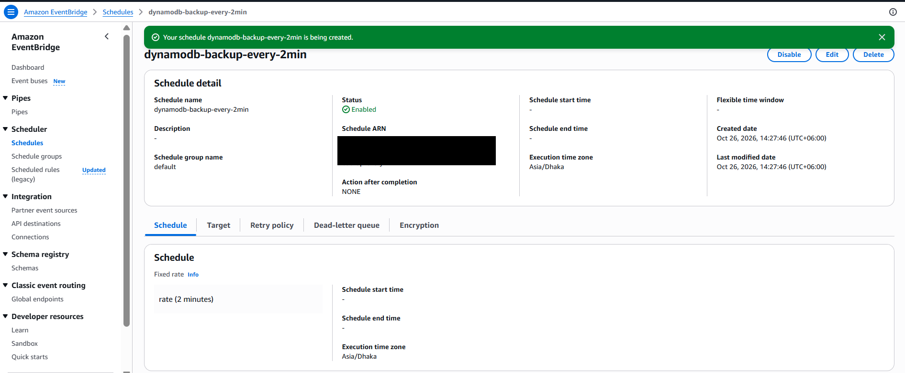

### 2.7 Automated proof
- About 24 S3 objects were created by the schedule, roughly 2 minutes apart, from 14:28 to 15:10 (Bangladesh time, UTC+6).
- Scheduled runs match CloudWatch invocations (e.g. 15:04:14 log, 15:04:15 invocation, and the S3 file `users-09-04-14-...json`).

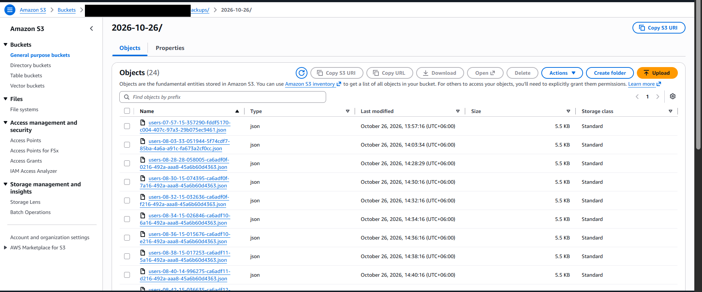
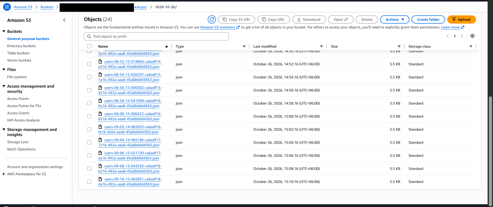

### 2.8 Observability
- Invocations (1 day): sum 24. Errors: max 0. Success rate: 100%.
- Duration: min 477 ms, average 526 ms, max 602 ms.
- Recent invocations show each run's request ID and duration.

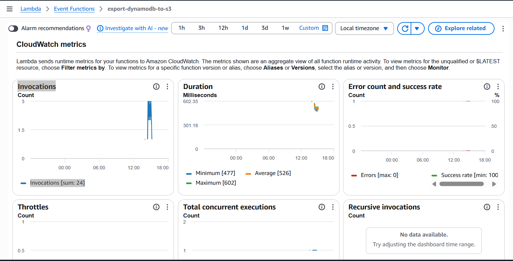
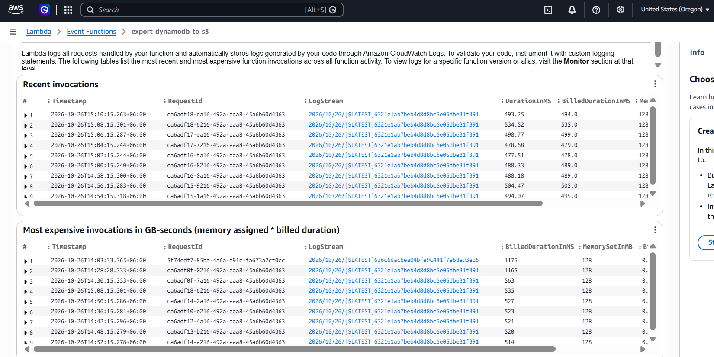

### 2.9 Cleanup
- Disabled and deleted the EventBridge schedule before removing its target resources.
- Deleted the 24 generated S3 backup objects, then deleted the lab bucket.
- Deleted both Lambda functions and their lab-only execution roles.
- Deleted the DynamoDB table and the two Lambda CloudWatch log groups.
- Cleanup evidence is grouped under `screenshots/cleanup/`. Account identifiers and unrelated bucket names are redacted.

| Resource | Cleanup evidence |
| --- | --- |
| EventBridge Scheduler | [Schedule deletion and empty schedule list](screenshots/cleanup/cleanup-scheduler-deleted.png) |
| S3 | [24 objects deleted](screenshots/cleanup/cleanup-s3-objects-deleted.png) · [Lab bucket deleted](screenshots/cleanup/cleanup-s3-bucket-deleted.png) |
| Lambda | [Functions before cleanup](screenshots/cleanup/cleanup-lambda-list-1.png) · [Import function deleted](screenshots/cleanup/cleanup-lambda-import-deleted.png) · [Export function deleted](screenshots/cleanup/cleanup-lambda-export-deleted.png) |
| IAM | [Roles after scheduler role removal](screenshots/cleanup/cleanup-iam-roles-list.png) · [Export role deleted](screenshots/cleanup/cleanup-iam-export-role-deleted.png) · [Import role deletion confirmation dialog](screenshots/cleanup/cleanup-iam-import-role-delete-confirmation.png) |
| DynamoDB | [Table before cleanup](screenshots/cleanup/cleanup-dynamodb-tables.png) · [Deletion submitted and table list empty](screenshots/cleanup/cleanup-dynamodb-deleted.png) |
| CloudWatch | [Both Lambda log groups deleted](screenshots/cleanup/cleanup-cloudwatch-log-groups-deleted.png) |

---

## 3. Questions

**Q1. What is the difference between Lambda's execution role and Scheduler's execution role?**
The Lambda execution role is what the function code uses to call AWS services (DynamoDB, S3, CloudWatch Logs). The Scheduler execution role is what EventBridge Scheduler uses to call `lambda:InvokeFunction` on the target. Scheduler does not run the function code, and the Lambda role does not trigger the schedule.

**Q2. Why does running Lambda #1 twice not produce 20 DynamoDB users?**
DynamoDB uses the partition key to identify items. `PutItem` with the same `id` replaces the existing item. The table keeps 10 items no matter how many times the import runs.

**Q3. Why do Lambda #2 backups have unique timestamps and request IDs?**
The object key includes the UTC date, time with microseconds, and the Lambda request ID. Every invocation therefore writes a new object and never overwrites a previous backup. The request ID also links each file to its CloudWatch log and invocation.

**Q4. What is the difference between `print()` logs and `Invocations`/`Errors` metrics?**
`print()` output is application logging. It records messages such as `SUCCESS: Exported 10 users` and is searched in CloudWatch Logs. `Invocations`, `Errors`, and `Duration` are runtime metrics that Lambda publishes automatically. They show how often the function ran, how many runs failed, and how long each run took. Logs explain what happened in a run. Metrics show trends over time.

**Q5. What if the DynamoDB table were deleted but its JSON files remained in S3?**
The JSON files contain the item data, so the items could be restored by writing them back. They would not restore the table's full configuration: key schema, indexes, capacity mode, PITR and backup settings, stream settings, IAM and resource policies, alarms, or tags. Those must be recreated manually. The JSON copy also reflects the moment of each scan, not a transactionally consistent snapshot.

**Q6. Why is an export every 2 minutes a poor production backup strategy for large tables?**
- A Scan reads every item and consumes read capacity on each run. Frequent full scans get expensive and can slow the application.
- A Scan is not a point-in-time snapshot. Items written during the scan may or may not be included, so exports can be inconsistent.
- Each run creates many objects, which raises S3 request costs and storage.
- Lambda time and memory limits can be exceeded for large tables.
- Production should use DynamoDB Point-in-Time Recovery (PITR) for restore to any second in the last 35 days, and DynamoDB Export to S3 for consistent, low-impact exports. Retention and frequency should follow RPO and RTO targets.

---

## 4. Notes
- The 2-minute schedule is a lab setting. It was disabled after the test.
- Account ID and personal identifiers are redacted in all screenshots.
- Lambda #2's execution role was edited in the console as part of the lab. Its final policy is shown in the screenshot above.
